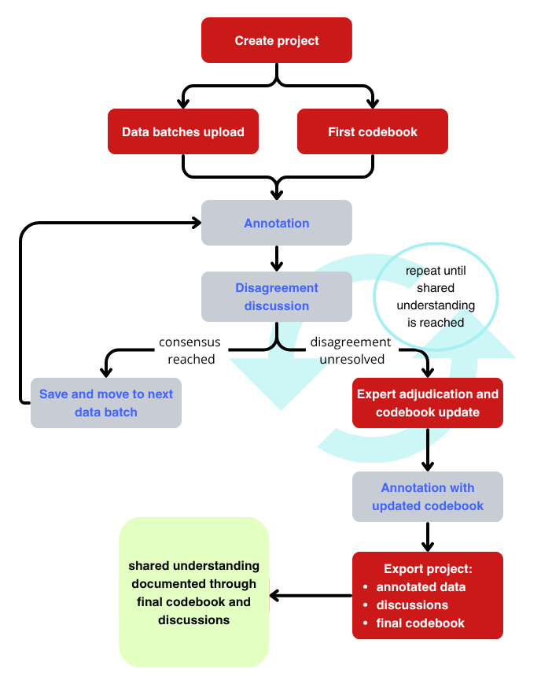

# Arbiter

[](LICENSE)
<!-- PLACEHOLDER: Docker badge, couldn't find the link -->
<!-- PLACEHOLDER: JOSS / DOI badge in the future -->

**Arbiter** is an open-source, collaborative web application for data annotation that treats
disagreement as useful information to use during the annotation process rather than noise to resolve post-hoc. Annotators label data in batches, discuss conflicting labels in a real-time chat, and pass unresolved cases to an expert who decides the
final label and revises the annotation guidelines (the _codebook_). Every label, discussion, and codebook revision is logged, so the evolution of the team's shared understanding of the task is documented alongside the dataset.

<!-- PLACEHOLDER: GIF of the workflow -->

## Why Arbiter?

Low inter-annotator agreement in subjective or complex tasks usually has one of two causes:

1. **Task underspecification:** the annotation guidelines are too generic, leaving the space for personal interpretation, especially for edge cases.
2. **Misapplication:** annotators misunderstand or wrongly apply the guidelines.

Post-hoc statistical methods model disagreement after the data has been collected.
Arbiter addresses it **during** annotation: misapplication is resolved by synchronous discussion between
annotators, underspecification by expert adjudication and in-tool codebook revisions.

## Workflow



1. **Setup:** an expert creates a project (labels, annotators, experts), writes the first
   codebook and uploads the first batch of data.
2. **Annotation:** annotators label the batch independently.
3. **Discussion:** samples with diverging labels enter a real-time chat between annotators. If
   they agree, the labels are updated; otherwise the sample is escalated to the expert.
4. **Expert decision:** the expert chooses the final label for escalated samples and, where
   needed, updates the codebook with a written rationale.
5. **Codebook synchronisation:** before the next batch, annotators read the codebook with all
   changes highlighted. The cycle repeats until the team has converged to a shared understanding of the guidelines.
6. **Export:** the annotated data, discussions, rationales and codebook history are exported.

## Key features

**Experts**

- Create projects with custom labels and assign annotators and experts
- Upload data in batches as CSV or XLSX (a `text` column is required; all other columns are kept as sample metadata)
- Review annotator labels and chat transcripts, set the final label and record a rationale
- Edit the codebook
- Export a single batch or the whole project as JSON files, including discussions and revision history

**Annotators**

- Label samples independently
- Discuss disagreements with peers in a real-time chat
- See what changed in the codebook since the previous batch

**Administrators**

- Manage user accounts, groups and permissions through the Django admin interface

## Installation and quick start

Arbiter runs as a set of Docker containers (web app, Vite, PostgreSQL, Redis), so the only
requirements are [Docker](https://docs.docker.com/get-docker/) with Compose and Git.

```bash
# 1. Get the code
git clone https://github.com/luerhard/arbiter.git
cd arbiter

# 2. Create a .env file with the database credentials (choose your own values)
cat > .env <<'EOF'
POSTGRES_DB=arbiter
POSTGRES_USER=myuser
POSTGRES_PASSWORD=mypassword
EOF

# 3. Build and start all services
docker compose up --build

# 4. In a second terminal: create the database tables
docker compose exec web uv run manage.py migrate

# 5. Either load demo data (see below) or create your own admin account
docker compose exec web uv run manage.py populatedb
# docker compose exec web uv run manage.py createsuperuser
```

Then open <http://127.0.0.1:8000>.

`populatedb` creates demo accounts for trying the tool: `admin`, `annotator1`, `annotator2`,
`expert1` and `expert2`, all with the password `123`. **These are for local development only; never
load them on a server that others can reach.**

To remove everything, including the database volume, run `docker compose down --volumes`.
`docker compose exec web uv run manage.py resetdb --noinput` drops and recreates the database
without removing the volume.

### Production deployment

`docker-compose.prod.yml` builds the production image (compiled frontend, Daphne ASGI server):

```bash
docker compose -f docker-compose.prod.yml up --build -d
```

In addition to the database variables, set `DJANGO_ALLOWED_HOSTS` and
`DJANGO_CSRF_TRUSTED_ORIGINS` (comma-separated) in `.env`. `./backup.sh` creates a full backup
(database dump plus media files, including all codebooks) in `./backups/`.

## Documentation

Documentation is built with Sphinx and published at **<https://luerhard.github.io/arbiter>**:

- **User guide** (experts, annotators, administrators): [`docs/usage`](docs/usage/index.md)
- **Developer guide** (setup, tests, debugging, architecture): [`docs/dev`](docs/dev/index.md)
- **API reference** (auto-generated from the code): [`docs/api`](docs/api/index.md)

## Architecture at a glance

- **Backend:** Django (5.1 to 6.x) on Python 3.13+, split into apps: `projects`, `annotation`,
  `discuss`, `expert`, `codebook`, `notifications`, `users` and `data`
- **Real-time discussion:** Django Channels over WebSockets (served by Daphne) with Redis as the channel layer
- **Database:** PostgreSQL
- **Codebook versioning:** each project's codebook is a Git repository (via GitPython); batches are tagged so diffs between batches can be shown
- **Frontend:** server-rendered Django templates (django-cotton components) with HTMX, Alpine.js and Tailwind CSS, bundled by Vite
- **Dependency management:** [uv](https://docs.astral.sh/uv/) for Python, npm for the frontend

## Tests

The test suite uses pytest and runs against the Docker Compose stack:

```bash
docker compose run --rm web uv run pytest -v
```

It runs automatically on every push and pull request to `main` through GitHub Actions. A small set
of Selenium smoke tests for the expert interface lives in `browser_tests/`; they run on the host
rather than in Docker (see the docstring in `browser_tests/conftest.py`).

## Contributing

Contributions are welcome. Please open an
[issue](https://github.com/luerhard/arbiter/issues) to report a bug or propose a feature before
starting larger changes, and send changes as a pull request against `main`.

- Set up the development stack as described in [Installation](#installation-and-quick-start) and in the [developer guide](docs/dev/index.md)
- Make sure `docker compose run --rm web uv run pytest` passes
- Code is formatted with [Ruff](https://docs.astral.sh/ruff/) and [Prettier](https://prettier.io/); the repository ships a [`.pre-commit-config.yaml`](.pre-commit-config.yaml) so this happens on commit

Complete guide for contributions: [Contributing Guidelines](CONTRIBUTING.md)

## Citation

If you use Arbiter in your research, please cite:

```bibtex
@article{PLACEHOLDER_arbiter,
  title   = {PLACEHOLDER},
  author  = {PLACEHOLDER},
  journal = {PLACEHOLDER},
  year    = {PLACEHOLDER},
  doi     = {PLACEHOLDER}
}
```

## License

Arbiter is released under the [MIT License](LICENSE).

## Acknowledgements

## Contact

Bugs and feature requests: [GitHub Issues](https://github.com/luerhard/arbiter/issues).
