# Usage

# General Info & Overview

## What is Arbiter?

**Arbiter** is an open-source collaborative software tool and web application designed to build and document a shared understanding during data annotation tasks.

In subjective or complex data annotation tasks, low inter-annotator agreement often derives from two primary sources:

1. **Task Underspecification**: Ambiguity or gaps in the annotation guidelines where existing rules are vague, making it difficult to determine the label, especially for edge/difficult cases.
2. **Misapplication**: Annotators misunderstanding or incorrectly applying guidelines.

Unlike traditional post-hoc statistical methods that attempt to model disagreement after data collection is complete, Arbiter addresses disagreement **during** the active annotation process.

### Key Features

- **Batch-Based Annotation and Real-Time Chat**: Data is annotated in structured batches. When label disagreements occur, annotators discuss them synchronously in an integrated real-time chat interface.
- **Expert Adjudication and Guideline Revision**: Disagreements that cannot be resolved between annotators are passed to an expert, who adjudicates the final label and updates the annotation guidelines (i.e., **codebook**).
- **Traceable Dataset Documentation**: Every label assignment, discussion, expert decision rationale, and guideline revision is logged. This creates a complete audit trail that documents how the team's interpretation evolved over time, serving as a reproducibility artifact for downstream dataset users.

## User Login

Type in the username and password provided by the admin. The login interface is the same for both type of users described below.
 
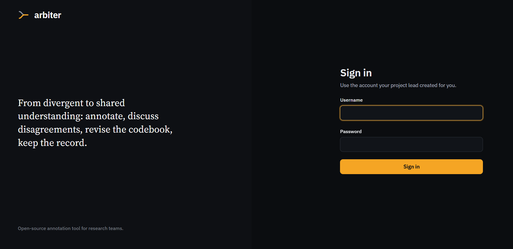

## User Roles and Workflow Description

Arbiter structures data labeling around three distinct user roles and a multi-stage collaborative loop.

### Users

- **Annotator**: Independently label data batches, deliberate with peers in real-time chat regarding disagreed samples to resolve misapplications, and review codebook updates prior to starting subsequent batches.
- **Expert**: Create projects, upload data batches, review annotators' unresolved disagreements, assign final adjudicated labels, provide explanatory rationales, and edit the codebook.
- **Administrator**: Manage groups and users.

### Workflow

################DIAGRAM#######################

1. **First batch and codebook upload**: Expert user uploads batches and the first version of the annotation guidelines.
2. **Annotation**: Annotators independently assign labels according to current codebook guidelines.
3. **Discussion (Resolving Misapplication)**: Once independent labeling for a batch is complete, samples with divergent labels automatically enter the discussion stage. Annotators use the real-time chat interface to discuss their reasoning. If they reach consensus, updated labels are saved. If they don't, the sample is passed to the Expert.
4. **Expert adjudication and codebook update (Resolving Underspecification)**: The expert selects the final decision for the samples with divergent label and updates the codebook to clarify the rule or edge case, writing the rationale on which is based the final decision.
5. **Codebook synchronization and maturation**: Before beginning the next batch, annotators read the updated codebook with changes highlighted. Over time, as guidelines mature, discussion counts and instruction edits decrease, signaling that the team has converged on a relatively stable, shared understanding.

---

## 2. Expert User Guide

### 1. Create a Project

To set up a new annotation project:

1. Log in with an Expert account and click **Create Project** in the navigation menu.
2. Fill out the project configuration form:
   - **Project title**: A name for your project.
   - **Description**: A summary defining the project scope and goals.
   - **Annotators & Experts**: Assign user profiles to their respective roles for this project.
   - **Labels**: Define labels along with custom display colors and hotkeys.
3. Click **Create Project** at the bottom of the page to finalize setup.

  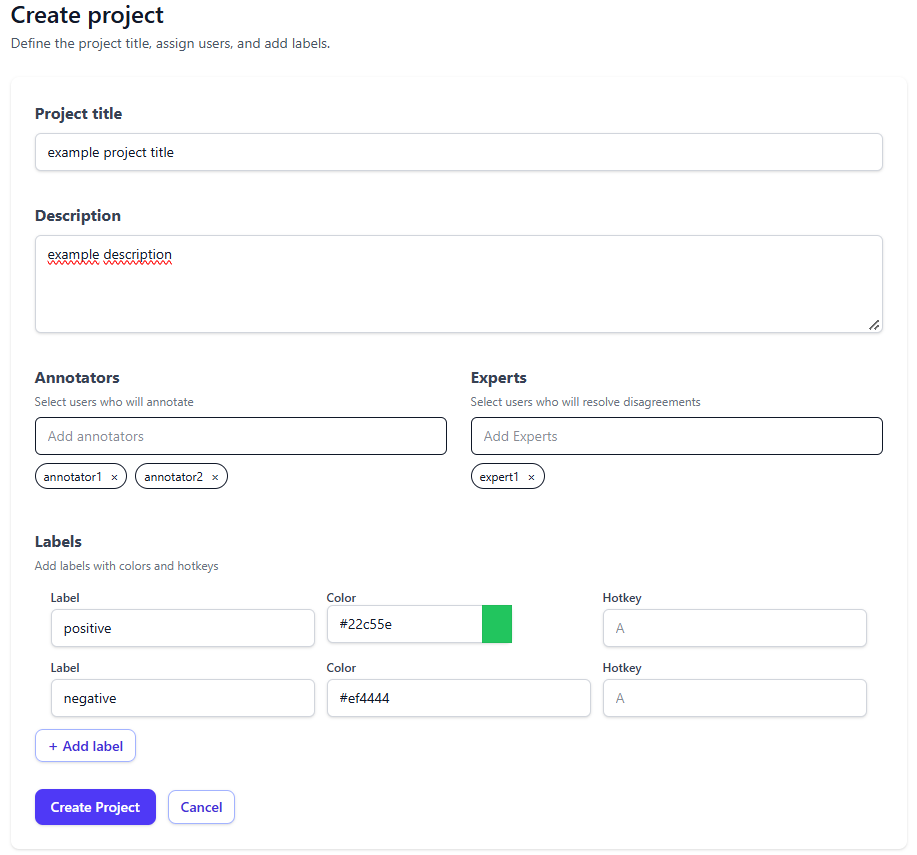 
  <b>Figure 2: Project Creation Form</b>. Filling in project title, description, user assignments, labels, display colors, and hotkeys.

---

### 2. Upload Batches

Once a project is created, data samples must be grouped and uploaded in batches:

1. Navigate to the project dashboard and click **Create Batch**.
2. In the modal dialog, select a dataset file (`CSV` or `XLSX` containing a `text` column) and select the designated annotators and experts for that batch.
3. Upon upload, the new batch appears in the project's **Batches** list in `Annotation` mode.

  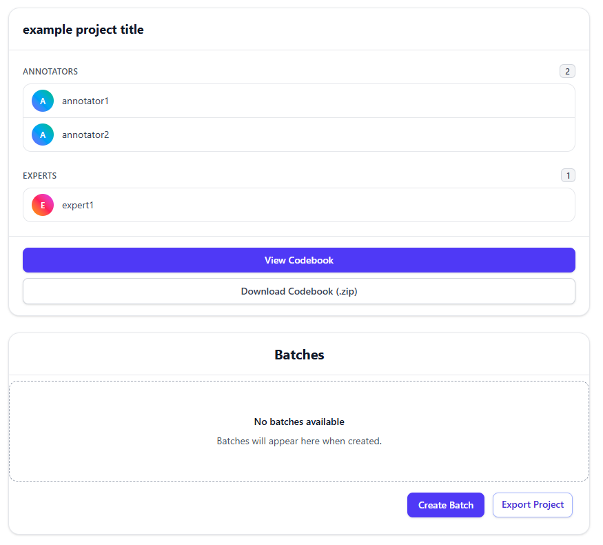 
  <b>Figure 3: Initial Project Dashboard</b>. Dashboard view prior to uploading dataset batches.

  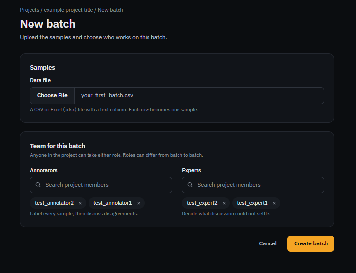 
  <b>Figure 4: Batch Creation Modal</b>. Uploading a dataset file and assigning specific annotators and experts to the batch.

  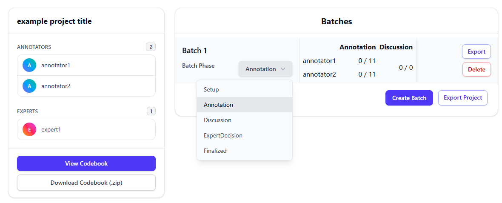 
  <b>Figure 5: Active Batch Dashboard</b>. Overview card displaying Batch 1 in the Annotation phase, showing real-time annotation progress per user.

---

### 3. First Codebook

After creating a batch, the Expert writes the initial annotation guidelines (Codebook):

1. Click **View Codebook** on the project dashboard.
2. Click **Edit**, enter the initial guideline instructions, write a rationale for the initial setup, and save.

  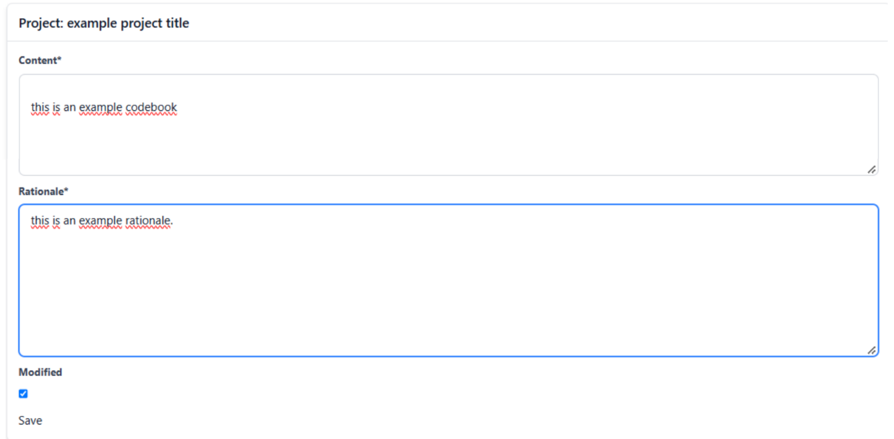 
  <b>Figure 6: Initial Codebook Setup</b>. Editor interface where Experts input first instructions and save the initial Codebook commit.

---

### 4. Resolve Disagreements and Edit the Codebook

When annotators complete peer discussion without reaching consensus on a sample, the batch transitions to the `ExpertDecision` phase.

1. Click **Resolve** on the batch card to open the adjudication panel.
2. Review the sample text, individual annotator labels, and the Annotators chat transcript.
3. Select the final adjudicated label for the sample.
4. Edit the Codebook instructions in the right-hand panel to address the underlying underspecification (e.g., adding an edge case rule).
5. Enter a detailed rationale explaining your decision and click **Save**.

> **Important Note**: In order for annotators to see highlighted Codebook changes when starting a new batch, the subsequent batch must already be created and in `Setup` mode when the Codebook edit takes place.

  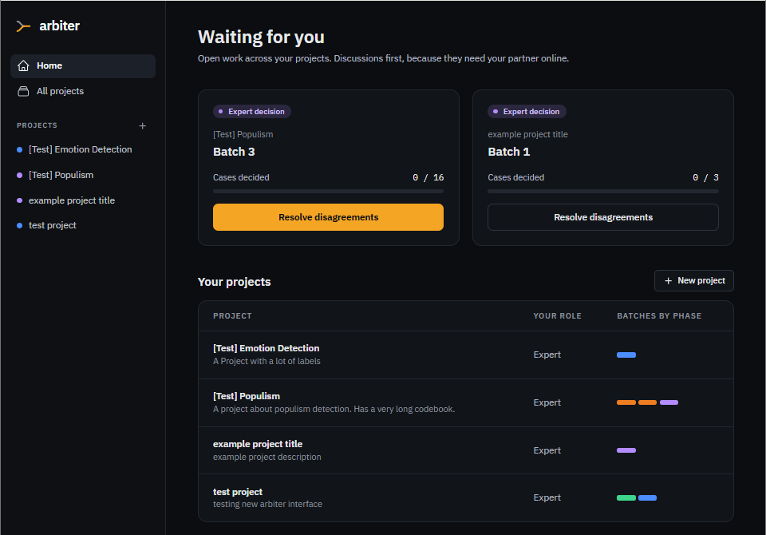 
  <b>Figure 7: Unresolved Disagreement Alert</b>. Batch dashboard card indicating cases needing expert adjudication via the "Resolve" button.

  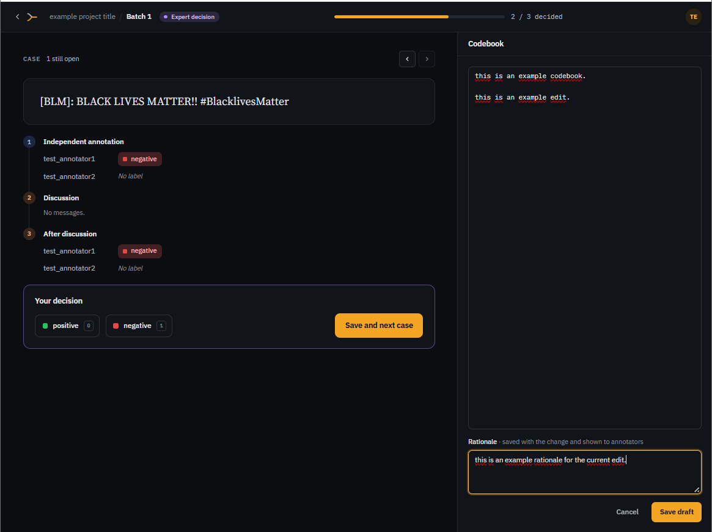 
  <b>Figure 8: Expert Adjudication & Codebook Revision Interface</b>. Comprehensive panel displaying sample text, annotator labels, chat history, final label selection, Codebook rule editing, and rationale logging.

---

### 5. Export Batch Data After Annotation and Discussion

When all annotations, discussions, and expert adjudications for a batch are complete:

- Click **Export** on an individual batch card to download its final labels, discussion transcripts, and revision history.
- Click **Export Project** to download the complete dataset and full Git-backed audit trail for the entire project.

  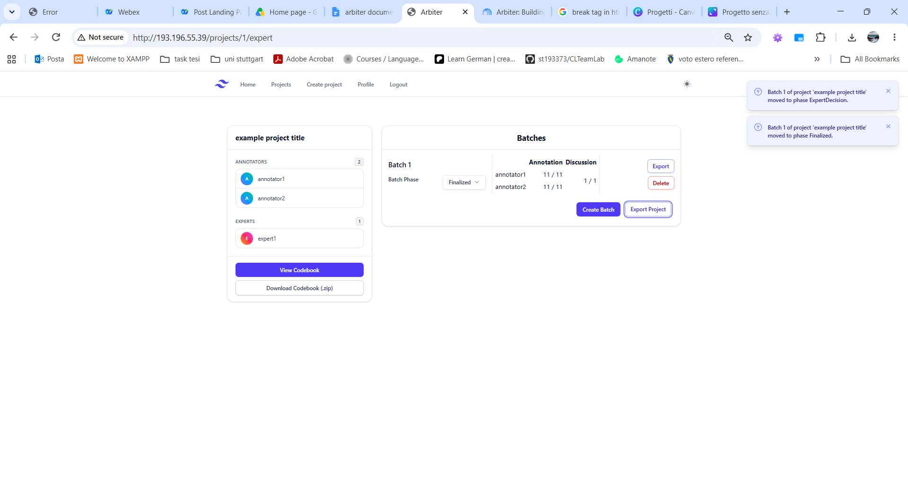 
  <b>Figure 9: Data Export Dashboard</b>. Finalized batch view offering individual batch or full project data export options.

---

## 3. Annotator User Guide

The Annotator role focuses on independent labeling, peer discussion of conflicting samples, and staying synchronized with evolving Codebook guidelines.

### Project Dashboard View

When logging in, Annotators see a summary of all assigned projects, active batches, and current phase statuses.

  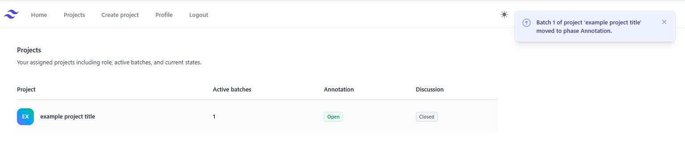 
  <b>Figure 10: Annotator Home Dashboard</b>. Overview of assigned projects, count of active batches, and current phase indicator.

---

### 1. First Batch Overview & Codebook View

Clicking on a project opens the batch management view:

- **Start Annotation**: Opens the labeling interface for the assigned batch.
- **View Codebook**: Opens the current annotation guidelines.
- **Open Codebook Changes**: Displays the codebook view showing newly added rules since the previous batch.

  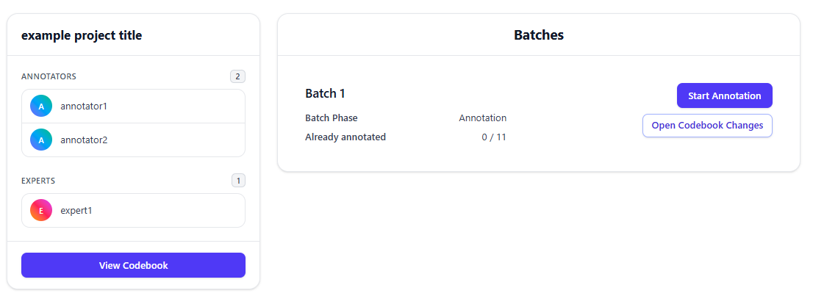 
  <b>Figure 11: Annotator Batch Overview Card</b>. Displaying assigned samples (0/11 annotated) and action buttons.

  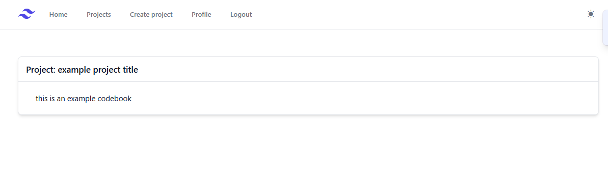 
  <b>Figure 12: Codebook</b>. Displaying instructions before any batch edits occur.

---

### 2. Annotation Phase

In the Annotation phase, annotators label each sample independently:

1. Read the presented text sample.
2. Click the appropriate candidate label button (or use custom keyboard shortcuts).
3. Navigate through samples using arrow buttons or keyboard shortcuts.
4. When finished, click **Finalize annotation**.

  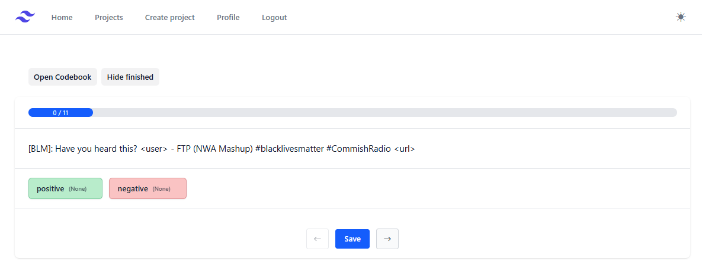 
  <b>Figure 13: Annotation Interface</b>. Single-sample labeling screen with progress bar, label selection buttons, and navigation controls.

  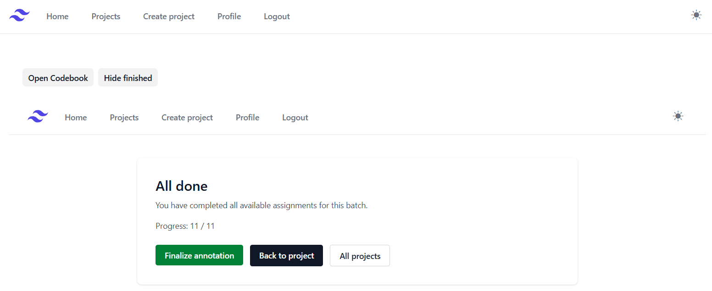 
  <b>Figure 14: Finalize Batch</b>. Completion prompt displayed when all samples in a batch have been labeled.

#### Keyboard Shortcuts

The annotation interface supports hotkeys for rapid labeling and navigation:

- **Left Arrow Key ($\leftarrow$)**: Move to the previous sample.
- **Right Arrow Key ($\rightarrow$)**: Move to the next sample.
- **Enter Key ($\hookleftarrow$)**: Save annotation (transmits current label selections to the server).
- **Custom Hotkeys**: Custom key bindings defined during project setup (e.g., key `A` for Positive, key `B` for Negative).

---

### 3. Peer Discussion Phase

When independent annotation is complete and label mismatches exist between annotators, the batch transitions to the `Discussion` phase.

1. Click **Start Discussion** on the batch card.
2. The split-screen discussion interface displays:
   - **Left Panel**: The sample text, your label, and your peer's label.
   - **Right Panel**: A real-time chat window.
3. Discuss the sample with your peer.
4. If you reach consensus, update your label selections. If you remain in disagreement, leave the conflicting labels as-is to escalate the sample to the Expert. Click **Save & Done**.

  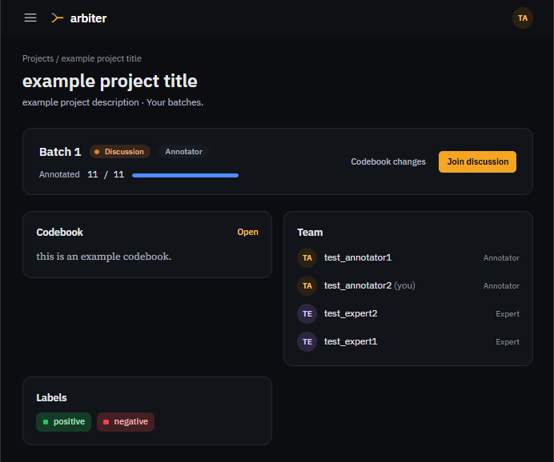 
  <b>Figure 15: Peer Discussion Alert</b>. Batch card notifying annotators that independent labeling is complete and peer discussion is open.

  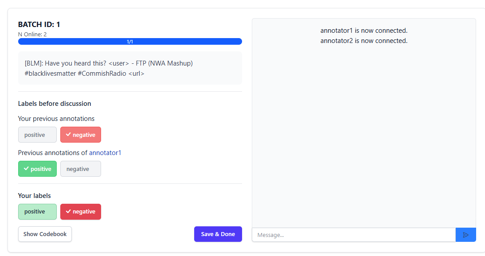 
  <b>Figure 16: Real-Time Peer Discussion Interface</b>. Split-screen workspace showing conflicting label choices, connection status, and live chat messaging.

---

### 4. View Codebook After Update

When the Expert adjudicates an escalated sample and updates the guidelines:

1. Upon entering the next batch, click **Open Codebook Changes**.
2. The Codebook view highlights all newly added or modified rules in highlighted format.

  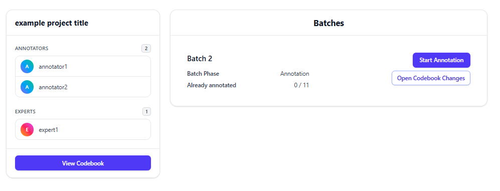 
  <b>Figure 17: Codebook Update</b>. Button on new batch card indicating updated guidelines are available.

  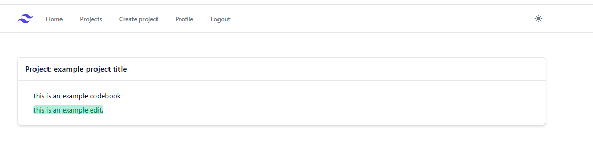 
  <b>Figure 18: Highlighted Codebook Edits View</b>. Updated guideline screen with newly added rules highlighted in green.

---

## 4. Admin User Guide

Administrators manage system deployment, user account creation, user group assignments, and Django permissions. Access the admin interface at `/admin` using administrator credentials.

### 1. Admin Homepage

Log in at `http://<your-server-ip>/admin`. The dashboard provides quick access to User and Group management, along with a log of recent administrative actions.

  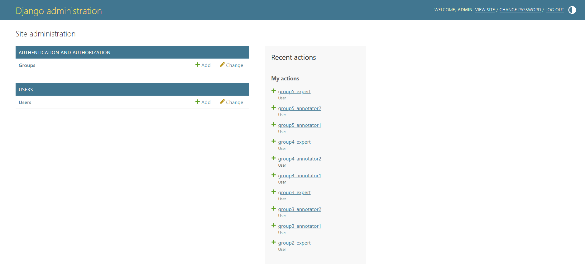 
  <b>Figure 19: Django Administration Homepage</b> — Central management portal for site administration, user accounts, and system logs.

---

### 2. Add Users

To register new Annotators or Experts:

1. Under **Users**, click **+ Add**.
2. Enter a unique username and password.
3. Click **Save** to create the user account.

  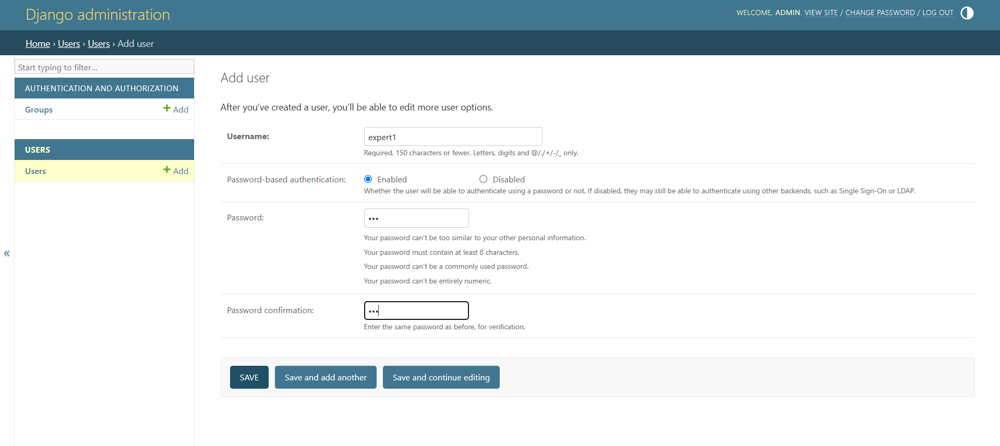 
  <b>Figure 20: User Registration Form</b> — Admin form for creating new user credentials.

---

### 3. Manage User Groups

Organize users into functional groups to streamline role assignments:

1. Navigate to **Groups** under Authentication and Authorization.
2. Use the dual-list selector to assign users to specific system groups (e.g., Annotators, Experts).

  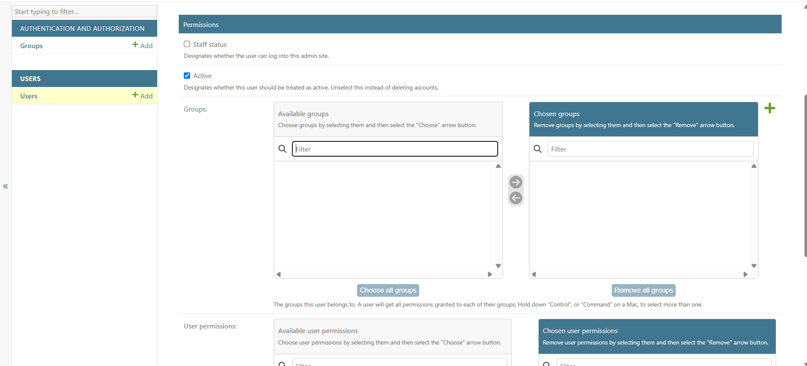 
  <b>Figure 21: User Group Management</b> — Interface for assigning users to designated functional groups.

---

### 4. Manage User Permissions

Fine-tune model-level access rights for specific accounts or groups:

1. Open a user account profile in the admin portal.
2. In the **User permissions** section, select specific Django model permissions (e.g., `Expert | codebook draft | Can add codebook draft`, `Projects | batch | Can add batch`).
3. Click **Save** to enforce permission settings.

  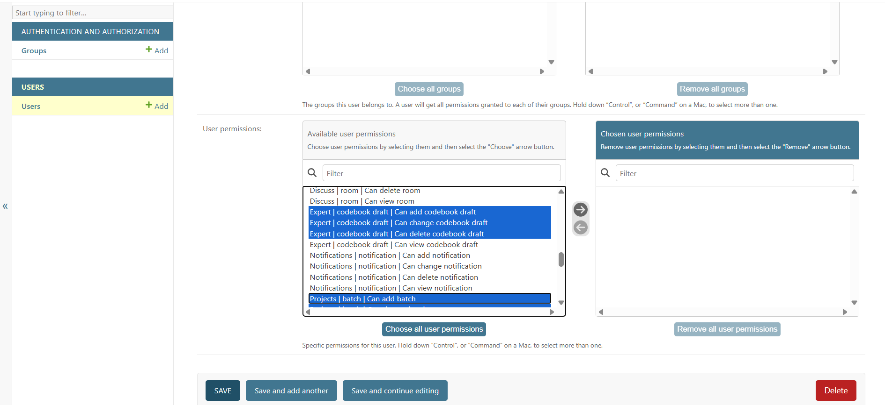 
  <b>Figure 22: Fine-Grained User Permissions</b> — Selector panel for assigning specific system and model permissions to user profiles.

